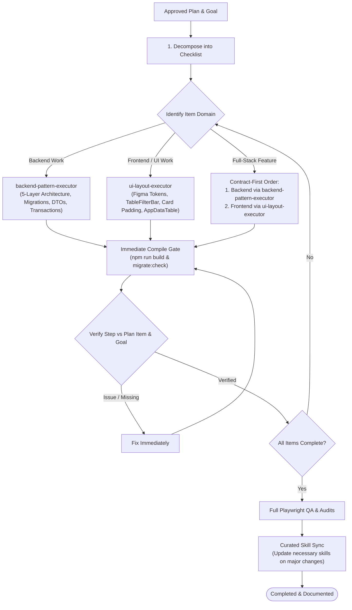

# Plan Executor: The Iterative Execution & Domain Routing Loop

This skill is the **central orchestration engine** for executing engineering plans and goals in **Orbito v2**. It connects all domain skills into a cohesive, uninterrupted execution workflow, eliminating unfinished tasks, missed requirements, premature stops, and silent regressions.

---

## 1. Domain Routing Architecture

When executing any plan, `plan-executor` automatically routes tasks to specialized domain skills based on the layer being modified:



### Domain Delegation Standards

| Domain | Assigned Skill | Mandatory Standards Enforced |
|---|---|---|
| **Backend** (API, Database, Logic) | [**backend-pattern-executor**](file:///Users/soham18/Desktop/orbito-v2/.agents/skills/backend-pattern-executor/SKILL.md) | Strict 5 layers (`Router` → `Middlewares` → `Controller` → `Service` → `Model`), atomic `sequelize.transaction()`, Zod DTO validation, zero-drift PostgreSQL migrations (`npm run migrate:check`), and RBAC checks (`authenticate`, `checkPermissions`). |
| **Frontend / UI** (Components, Pages, CSS) | [**ui-layout-executor**](file:///Users/soham18/Desktop/orbito-v2/.agents/skills/ui-layout-executor/SKILL.md) | Standard design tokens, strict 2-font rule (`Inter` UI, `font-mono` machine data), `.panel-card p-4 sm:p-5 overflow-hidden` padding, reusable `<TableFilterBar>`, `<AppDataTable>`, `<TwoLineCell>`, clean `PageHeader` (no title badges), and the 8-file module pattern. |
| **Full-Stack** (End-to-End Features) | Both (Contract-First) | Implement and verify backend API and migrations first via `backend-pattern-executor`, then implement UI and state layers via `ui-layout-executor`. |

---

## 2. Step-by-Step Execution Protocol

### Step 1: Decompose Plan into Checklist
Extract all atomic deliverables from the plan into an explicit, domain-tagged checklist:
- `[Backend]` Database migrations, models, services, controllers, route bindings.
- `[Frontend]` API client, query hooks, column definitions, filter bar, list/form pages.
- `[UI/UX]` Spacing, card padding, cell vertical centering, multi-content wrapping, responsiveness.

### Step 2: Route & Implement Atomic Deliverable
- **If Backend:** Activate [backend-pattern-executor](file:///Users/soham18/Desktop/orbito-v2/.agents/skills/backend-pattern-executor/SKILL.md). Never skip layers or place business logic in controllers.
- **If Frontend:** Activate [ui-layout-executor](file:///Users/soham18/Desktop/orbito-v2/.agents/skills/ui-layout-executor/SKILL.md). Never hardcode ad-hoc buttons or invent fonts. Use `@/components/common` components.
- Keep component and file limits in check (target <= 400 lines for React components, <= 500 lines for backend services).

### Step 3: Immediate Compile & Verification Gate
After modifying files for the deliverable, run verification commands in terminal immediately:
```bash
# Frontend check (if frontend files touched)
cd frontend && npm run build

# Backend check (if backend files touched)
cd backend && npm run build
cd backend && npm run migrate:check
```
If errors occur, fix them immediately before advancing to the next item.

### Step 4: Verification Against Goal & Regression Check
Audit the deliverable against the user's intent:
- Did this fix the root cause without introducing side-effects?
- Does it maintain consistency with adjacent screens and existing design tokens?
- Does it honor both light mode and dark mode equally?

### Step 5: Loop Continuously Until 100% Complete
Advance to the next checklist item and repeat Steps 2–4. **Do not stop or return prematurely** until every item in the checklist and user goal is completed and confirmed working.

### Step 6: Comprehensive End-to-End Verification & Browser QA
When all checklist items are implemented:
1. Execute Playwright QA (`playwright-qa`) to test complete user journeys.
2. Verify across Desktop (`1440x900`), Tablet (`768x1024`), and Mobile (`375x667`).
3. Inspect `browser_console_messages` and `browser_network_requests` for zero runtime errors.
4. Capture screenshot evidence across light and dark themes.

### Step 7: Curated Skill Sync (Update Necessary Skills on Major Changes)
Whenever major architectural shifts, new common components, or modified workflow standards are implemented:
- **Update the necessary skills:** Record durable conventions in `.agents/skills/` (e.g., `ui-layout-executor`, `backend-pattern-executor`, `architecture`) and `AGENTS.md`.
- **Do NOT update everything:** Do not log trivial one-off bug fixes, daily logs, or changelogs. Only capture reusable patterns and architectural rules that prevent future inconsistencies.

---

## 3. Checklist for Plan Executor Completion

Before concluding any execution run, confirm:
- [ ] Every checklist item from the approved plan is fully implemented in active code.
- [ ] Backend changes adhere to `backend-pattern-executor` (5 layers, zero-drift migrations).
- [ ] Frontend changes adhere to `ui-layout-executor` (design tokens, card padding, common components).
- [ ] `cd backend && npm run build` and `cd backend && npm run migrate:check` pass.
- [ ] `cd frontend && npm run build` passes with zero TypeScript or lint errors.
- [ ] Browser QA executed via Playwright MCP with visual proof across viewports and themes.
- [ ] Necessary skills updated in `.agents/skills/` with durable standards to prevent future inconsistency.
