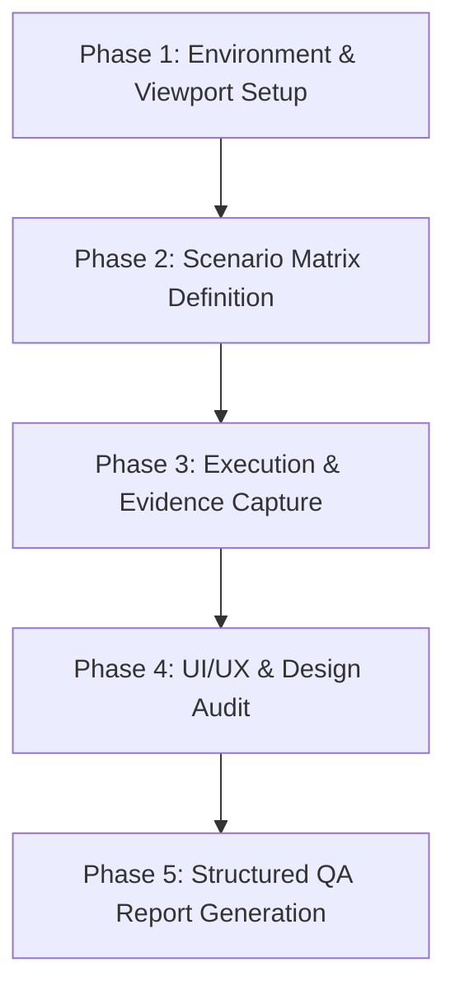

# Playwright QA & UI/UX Audit Runbook

This skill guides AI agents through autonomous, systematic Quality Assurance (QA) and UI/UX testing of frontend web applications in **Orbito v2** using the **Playwright MCP** server.

---

## 1. When to Run This Skill

Activate this skill:
1. **During Step 5 of the Workflow (Verification):** Whenever a UI page, form, modal, table, or interactive flow is created or modified, run QA tests to verify visual rendering, interaction flows, and responsive layouts before declaring completion.
2. **On Explicit User Request:** Whenever the user asks to "QA this page", "test in browser", "take screenshots", "test scenarios", "audit UI/UX", or "generate a QA report".
3. **Before Major Releases / Pull Requests:** To produce visual evidence and regression proof for stakeholders.

> [!IMPORTANT]
> **Scope Constraint:** Playwright MCP is strictly and exclusively reserved for local application QA and verification (`http://localhost:3000`). **Never** use Playwright to navigate to, scrape, or screenshot external Figma design URLs (`figma.com/design/...`). All Figma designs must be analyzed exclusively through the official Figma MCP server (`get_figma_data`, `download_figma_images`).

---

## 2. Playwright MCP Tool Mapping

Playwright tools are lazily-loaded MCP tools on the `playwright` server. Always invoke them using `call_mcp_tool`:

| MCP Tool Name | Primary Purpose in QA | Key Arguments |
|---|---|---|
| `browser_navigate` | Navigate to local dev URL or test route | `{ "url": "http://localhost:5173/..." }` |
| `browser_snapshot` | Inspect accessibility tree & discover element targets/selectors | `{ "boxes": true }` |
| `browser_resize` | Test responsive breakpoints (Desktop, Tablet, Mobile) | `{ "width": 1440, "height": 900 }` |
| `browser_click` | Click buttons, tabs, row actions, filters, dropdowns | `{ "target": "selector_or_snapshot_ref" }` |
| `browser_fill_form` | Populate form inputs in a single efficient call | `{ "fields": [{ "target": "...", "value": "..." }] }` |
| `browser_type` | Type text character-by-character into inputs/search bars | `{ "target": "...", "text": "..." }` |
| `browser_press_key` | Trigger keyboard events (`Enter`, `Escape`, `Tab`) | `{ "key": "Enter" }` |
| `browser_select_option`| Choose `<select>` options | `{ "target": "...", "values": ["val"] }` |
| `browser_wait_for` | Wait for network response, DOM mutation, or element visibility | `{ "target": "...", "state": "visible", "timeout": 5000 }` |
| `browser_take_screenshot` | Capture visual evidence of rendered UI or specific element | `{ "scale": "device", "fullPage": true, "filename": "..." }` |
| `browser_console_messages` | Audit console errors, warnings, and unhandled exceptions | `{ "level": "warning", "all": true }` |
| `browser_network_requests` | Audit failed API calls (4xx, 5xx) or slow requests | `{ "all": true }` |
| `browser_close` | Cleanly terminate the browser session when QA is done | `{}` |

---

## 3. The 5-Phase QA Execution Protocol

Follow this structured protocol for every QA run:



### Phase 1: Environment & Viewport Setup
1. **Ensure Local Server is Running:** Confirm the frontend is running (default `http://localhost:5173`). If needed, start it using `npm run dev` with `run_command` (as daemon).
2. **Define Test Viewports:** Test across the 3 standard responsive breakpoints:
   - **Desktop:** `1440 x 900` (Full sidebar, wide data grid, expanded filter bar).
   - **Tablet:** `768 x 1024` (Mini sidebar 80px, responsive data grid with horizontal scroll, stacked action bar).
   - **Mobile:** `375 x 667` (Off-canvas drawer navigation, wrapped headers, full-width touch-target buttons).
3. **Initialize Playwright:** Call `browser_navigate` to load the target route.

### Phase 2: Scenario Matrix Definition
Before clicking around, define a minimum of **4 to 6 focused scenarios**:
- **Scenario A (Happy Path):** Page load, data rendering, search input filtering, pagination.
- **Scenario B (Interaction & Modals):** Opening create/edit form, dropdown selection, modal trigger, tab switching.
- **Scenario C (Validation & Error States):** Submitting empty form, submitting invalid formats (email, phone), checking inline error messages.
- **Scenario D (Edge Cases & Empty States):** Zero search results state, long text truncation, extreme filters.
- **Scenario E (Responsive Layout):** Hamburger menu toggle on mobile, layout containment, sticky header behavior.

### Phase 3: Execution & Evidence Capture
For each scenario in the matrix:
1. **Inspect DOM:** Call `browser_snapshot` to locate the exact interactive target reference.
2. **Perform Action:** Call `browser_click`, `browser_fill_form`, or `browser_type`.
3. **Wait for State Settle:** Call `browser_wait_for` (or small delay) to ensure CSS transitions and React Query updates finish.
4. **Capture Screenshot:** Call `browser_take_screenshot`:
   - Use `scale: "device"` for crisp, retina-grade resolution.
   - Set `fullPage: true` for full layout audits, or provide `target` for modal/panel focus.
   - Name files descriptively: `qa-<module>-<scenario>-<viewport>-<status>.png` (e.g. `qa-licensing-create-validation-desktop.png`).
5. **Collect Diagnostics:** Call `browser_console_messages` and `browser_network_requests` to log any silent runtime exceptions.

### Phase 4: UI/UX & Design Audit
Evaluate the rendered UI against Orbito v2 standards (`ui-layout-executor`):
- **Typography & Font Integrity:** Inter exclusively for general UI; `font-mono` exclusively for machine data (plates, speeds, timestamps, coordinates). Zero unauthorized fonts.
- **Visual Hierarchy & Contrast:** Clear distinction between primary and secondary buttons; `.panel-card` contrast; readable text hierarchy (`h1`, `h2`, table headers).
- **Touch Targets & Spacing:** Minimum 44x44px clickable areas for buttons and icon controls (`.touch-target`). Consistent spacing (`p-4`, `p-6`, `gap-4`).
- **Feedback & Micro-interactions:** Visible hover states, focus rings (`.focus-ring`), clear loading skeletons during query fetches, descriptive inline validation errors.
- **Responsive Overflow & Breakpoints:** No unwanted horizontal viewport scrollbar on mobile; tables handle overflow via smooth horizontal containment.

### Phase 5: Structured QA Report Generation
Compile findings into a clean Markdown QA artifact and present an executive summary to the user.

---

## 4. UI/UX Feedback Taxonomy

When documenting UX recommendations during QA, categorize each finding using these tags:

| Tag | Focus Area | Example Finding |
|---|---|---|
| `ux-flow:` | User journey & friction | "Form submission resets entire page instead of preserving list filter state." |
| `layout:` | Spacing, alignment, overflow | "Action buttons wrap awkwardly on 768px tablet view; apply `flex-wrap justify-end`." |
| `typography:` | Hierarchy & font compliance | "Coordinates table cell is using standard Inter instead of required `font-mono`." |
| `contrast:` | Legibility & theme fidelity | "Secondary badge text has insufficient contrast ratio against light gray card background in dark mode." |
| `target:` | Touch targets & accessibility | "Table row delete icon button is 28x28px; increase hit target to 44x44px using `.touch-target`." |
| `feedback:` | Errors, loading, empty states | "No empty state illustration or text when search query returns 0 records; displays empty blank box." |

---

## 5. Standard QA Report Template

When generating the QA report artifact (saved in `<artifactDir>/qa_report_<module>.md`), use this exact structure:

```markdown
# QA Test Report: [Module / Feature Name]

**Target Route:** `http://localhost:5173/...`
**Execution Date:** YYYY-MM-DD
**Tested Viewports:** Desktop (1440x900), Tablet (768x1024), Mobile (375x667)
**Overall Result:** ✅ PASSED | ⚠️ PASSED WITH WARNINGS | ❌ FAILED

---

## 1. Executive Summary
- Brief 2-3 sentence overview of what was tested, pass rate, and general stability/UX impressions.

---

## 2. Test Scenario Matrix

| ID | Scenario | Viewport | Expected Result | Actual Result | Status | Screenshot |
|---|---|---|---|---|---|---|
| TC-01 | Default Directory Load | Desktop (1440x900) | Data table displays records with action buttons | Rendered correctly with 12 items | ✅ PASSED | [View Screenshot](...) |
| TC-02 | Search Query Filtering | Desktop (1440x900) | Filters table rows dynamically | Filtered to 2 matching records | ✅ PASSED | [View Screenshot](...) |
| TC-03 | Form Validation Trigger | Desktop (1440x900) | Displays inline red error messages on empty submit | Validation messages shown | ✅ PASSED | [View Screenshot](...) |
| TC-04 | Responsive Mobile Nav | Mobile (375x667) | Hamburger opens drawer, table scrollable | Layout contained, drawer functions | ✅ PASSED | [View Screenshot](...) |

---

## 3. Visual Evidence Gallery

### Desktop View (1440 x 900)

*Caption: Default state showing header, filter toolbar, and AG Grid directory.*

### Form & Validation State

*Caption: Inline Zod validation messages displayed under required fields.*

### Mobile Responsive View (375 x 667)

*Caption: Mobile navigation drawer opened with touch targets.*

---

## 4. Console & Network Health

- **Console Status:** 0 Errors, 1 Warning (React Query cache notice).
- **Network Status:** All API endpoints returned HTTP 200 OK. Average response latency: ~68ms.

---

## 5. UI/UX Audit & Actionable Improvements

1. `feedback:` **Empty Search State:** When a search returns zero results, display a dedicated empty state illustration with a "Clear Search" button instead of an empty grid.
2. `target:` **Action Menu Touch Targets:** Increase row action icon hit areas to 44x44px for better mobile touch usability.
3. `layout:` **Header Button Stacking:** On tablet portrait (768px), primary CTA buttons in `PageHeader` wrap onto two lines; convert to a compact flex row.
```

---

## 6. Pre-Flight QA Checklist

Before concluding any QA run:
- [ ] Tested on at least Desktop (1440px) and Mobile (375px).
- [ ] Captured at least one high-resolution screenshot (`scale: "device"`) for each critical state (List, Form, Validation, Mobile).
- [ ] Checked `browser_console_messages` for silent React rendering errors or unhandled promises.
- [ ] Checked `browser_network_requests` for failed 4xx/5xx requests.
- [ ] Audited typography compliance (Inter + font-mono telematics only).
- [ ] Published the structured QA report artifact and summarized top UX improvements in the final response.
- [ ] Closed browser session cleanly via `browser_close`.
