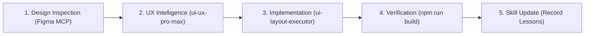
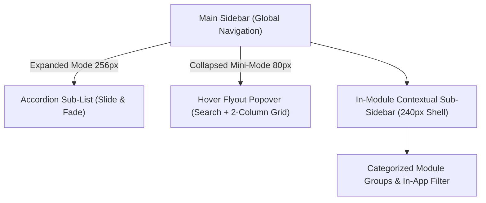
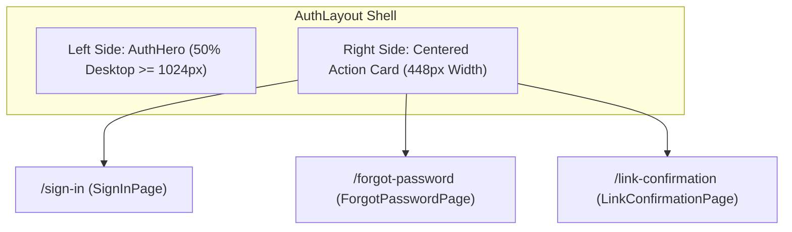

# Orbito v2 UI & Layout Implementation Guide (UI Layout Executor)

This guide documents the mandatory workflow, design tokens, common classes, and component patterns established for **Orbito v2** and the **inOrbit fleet** design system. 

> [!IMPORTANT]
> **Workflow Integration:** This skill is the specialized frontend and UI layout domain engine invoked by [**plan-executor**](file:///Users/soham18/Desktop/orbito-v2/.agents/skills/plan-executor/SKILL.md). Whenever planning or executing **ANY UI-related changes**, you **MUST** follow the pre-flight design analysis workflow in Section 1, adhere strictly to the layout architecture, and complete the post-implementation skill update protocol in Section 9.

---

## 1. Mandatory Pre-Flight Workflow: UI Analysis & UI/UX Pro Max

Before creating a plan or writing UI code, you must execute these two pre-flight analysis steps:



### Step 1.1: Inspect Source Design (Figma MCP)
If a Figma design URL or node ID is provided in instructions or prompt:
1. Extract the `fileKey` (e.g. `HoTxCrL3KrH5bblZDaw844`) and optional `nodeId` (e.g. `3004:240`).
2. Call the `figma` MCP tool `get_figma_data` with `{ "fileKey": "...", "nodeId": "..." }`.
3. Extract layout hierarchies, dimensions, padding, colors, and typography styles directly from the node tree.
4. If image assets or custom vector graphics are needed, use `download_figma_images` to save them directly to `frontend/src/assets/` or `frontend/src/components/common/icons/`.

### Step 1.2: Run UI/UX Pro Max Design Intelligence
Always invoke the globally installed **`ui-ux-pro-max`** skill via CLI to analyze design patterns, UX outcomes, and stack best practices:

```bash
# 1. Product & Design System Guidance (Color harmony, visual hierarchy, typography)
python3 ~/.agents/skills/ui-ux-pro-max/scripts/search.py "<product_feature> enterprise telematics" --design-system -p "Orbito Fleet"

# 2. Targeted UX & Accessibility Outcomes (WCAG 2.1 AA, touch targets, focus states)
python3 ~/.agents/skills/ui-ux-pro-max/scripts/search.py "<component_name_or_interaction>" --domain ux

# 3. Stack-Specific Implementation Guidance (Tailwind CSS 4 & React 18)
python3 ~/.agents/skills/ui-ux-pro-max/scripts/search.py "<concern>" --stack html-tailwind
python3 ~/.agents/skills/ui-ux-pro-max/scripts/search.py "<concern>" --stack react
```

---

## 2. Quick Reference: The 5-Layer Layout System

```text
1. Shell:        AppLayout (SkipToContent link, Sidebar, Header, fluid layout-container)
2. Navigation:   Sidebar (Desktop 256px / Tablet mini 80px / Mobile drawer 288px)
3. Topbar:       Header (Mobile hamburger, global search, notifications bell, user menu)
4. Context Bar:  PageHeader (Breadcrumbs, Title + status badge, description, responsive actions)
5. Content Area: Fluid Canvas (100% width, responsive gutters, horizontal table scrolling)
```

---

## 3. Design Tokens & Color Variables

All colors and visual properties are defined in [`frontend/src/index.css`](file:///Users/soham18/Desktop/orbito-v2/frontend/src/index.css). Always use these tokens instead of ad-hoc hex values:

| Token / Variable | Hex Value | Usage |
|---|---|---|
| `--color-brand-primary` | `#2563EB` | Active nav items, primary buttons, avatar backgrounds |
| `--color-brand-primary-hover` | `#1D4ED8` | Primary button hover state |
| `--color-brand-accent-cyan` | `#95F8FF` | "fleet" pill badge, telematics indicators |
| `--color-sidebar-bg` | `#0F172B` | Dark navy sidebar background (light & dark mode) |
| `--color-sidebar-border` | `#1D293D` | Sidebar right border, dividers, card borders |
| `--color-sidebar-item-idle` | `#7B7F8A` | Inactive nav links |
| `--color-status-danger` | `#EF4444` | Notification badges, alert counters, delete actions |
| `--color-status-success` | `#10B981` | Active entity status, connected status dot |
| `--color-status-warning` | `#F59E0B` | Expiry warning, caution indicators |

### 3.1 Typography Scale & Tokens (`@theme` & CSS Variables)

> [!IMPORTANT]
> **Strict 2-Font Policy (Non-Negotiable):**
> 1. **Primary UI Font (`Inter`):** Use exclusively for all user interface elements (headings, body copy, form fields, buttons, dropdowns, navigation, modals, and tooltips).
> 2. **Telematics Machine Font (`font-mono`):** Use exclusively for tabular machine & sensor figures (vehicle plate numbers, GPS coordinates, timestamps, speeds, battery voltages, hardware IMEIs, and SIM numbers).
> 3. **NO OTHER FONTS ALLOWED:** Never import, configure, or use any other font family (no Poppins, Roboto, Open Sans, Montserrat, etc.).
> 4. **Self-Hosted Only (Zero External CDNs):** All fonts must be self-hosted locally in `frontend/public/fonts/inter/`. Never load fonts from Google Fonts (`fonts.googleapis.com`), external `@import`, or third-party CDNs.
> 5. **No Arbitrary Bracket Font Sizes:** Never write ad-hoc arbitrary Tailwind bracket classes like `text-[10px]` or `text-[11px]`. Always use the standardized design tokens below.

| Token / Class | Size (px / rem) | Line Height | Usage Standard |
|---|---|---|---|
| `--text-2xs` (`text-2xs`) | `10px` / `0.625rem` | `14px` (`0.875rem`) | Micro alert counts (`.badge-alert`), table headers (`.text-table-header`), dense status chips |
| `--text-xs-compact` (`text-xs-compact`) | `11px` / `0.6875rem` | `16px` (`1rem`) | Telematics unit labels (`.text-telematics-label`), driver phone metadata, cyan badge (`.badge-cyan`) |
| `--text-xs` (`text-xs`) | `12px` / `0.75rem` | `16px` (`1rem`) | Primary tabular cells, form labels, small buttons, subtext, breadcrumbs |
| `--text-table` (`text-table`) | `13px` / `0.8125rem` | `18px` (`1.125rem`) | AG Grid table rows (`--ag-font-size: 13px`) and dense data grids |
| `--text-sm` (`text-sm`) | `14px` / `0.875rem` | `20px` (`1.25rem`) | Form inputs, dropdown options, sidebar nav links (`.nav-item-base`), button `md`, toasts |
| `--text-base` (`text-base`) | `16px` / `1rem` | `24px` (`1.5rem`) | Modal body descriptions, button `lg`, lead copy |
| `--text-lg` (`text-lg`) | `18px` / `1.125rem` | `28px` (`1.75rem`) | Card section headers, dialog titles |
| `--text-xl` (`text-xl`) | `20px` / `1.25rem` | `28px` (`1.75rem`) | Modal headers, compact page headers, KPI metric titles |
| `--text-2xl` (`text-2xl`) | `24px` / `1.5rem` | `32px` (`2rem`) | Main page titles (`PageHeader`), large fleet metric counters (`.text-metric-value`) |
| `--text-3xl` (`text-3xl`) | `30px` / `1.875rem` | `36px` (`2.25rem`) | Responsive page header titles (`sm:text-3xl`), reports navigator hero |
| `--text-4xl` (`text-4xl`) | `36px` / `2.25rem` | `40px` (`2.5rem`) | Authentication split-screen hero headline (`AuthHero.tsx`) |

---

## 4. Common Utility Classes (`@layer components`)

Orbito v2 provides pre-built utility classes in `index.css`. Always prefer these over duplicate utility strings:

### 4.1 Surfaces & Panels
- **`.panel-card`**: Standard card surface with 16px radius, border, and elevation (adapts to light and dark modes).
- **`.panel-glass`**: Glassmorphic surface with backdrop blur for headers, sticky bars, and overlays.
- **`.panel-sidebar`**: Theme-responsive sidebar canvas styling (`bg-white border-slate-200 text-slate-800` in light mode, and `dark:bg-[#0F172B] dark:border-[#1D293D] dark:text-slate-100` in dark mode).

### 4.2 Interactivity & Accessibility (A11y)
- **`.focus-ring`**: WCAG 2.1 AA compliant keyboard focus ring (`focus-visible:ring-2 focus-visible:ring-blue-500 focus-visible:ring-offset-2`).
- **`.touch-target`**: Minimum 44x44px touch-friendly hit area (`min-h-[44px] min-w-[44px]`).

### 4.3 Navigation States & Collapsed Tooltips
- **`.nav-item-base`**: Common transition, padding, border-radius, and font styling for navigation links.
- **`.nav-item-active`**: Royal blue pill (`#2563EB`) with subtle elevation shadow and white text.
- **`.nav-item-idle`**: Inactive navigation state (`text-slate-600 hover:bg-slate-100` in light mode, `dark:text-[#7B7F8A] dark:hover:bg-[#1D293D]/70 dark:hover:text-white` in dark mode).
- **Collapsed Sidebar Overflow Rule**: When the sidebar is collapsed (`w-20` / 80px), the outer aside, parent container, and `<nav>` list must switch from `overflow-hidden` to `overflow-visible` so that floating tooltips and cascading flyouts never cause horizontal scrollbars or get clipped. Floating tooltips and popovers must use `z-[60]`.

### 4.4 Badges & Pills
- **`.badge-pill`**: Standard rounded pill container with uppercase tracking.
- **`.badge-alert`**: Small red capsule for notification and alert counts (e.g. `3`).
- **`.badge-cyan`**: Cyan italic capsule for brand badges.
- **`.badge-counter`**: Clean slate counter badge for entity totals (e.g. `48 USERS`).

### 4.5 Responsive Containers
- **`.layout-container`**: Full-bleed fluid padding (`px-4 py-4 sm:px-6 sm:py-6 lg:px-8`).
- **`.toolbar-responsive`**: Action toolbar that stacks vertically on mobile (`flex-col`) and aligns horizontally on tablet/desktop (`sm:flex-row`).

---

## 5. The Common Icons Module (`frontend/src/components/common/icons/`)

Never copy-paste inline SVGs or import disparate icon libraries across files. Use the centralized icons module:

```tsx
import { AppIcon, InOrbitLogo, AuditLogIcon, SupportIcon } from "@/components/common/icons";
import { Plus, Filter, Download } from "lucide-react";

// 1. Standard decorative icon (aria-hidden by default)
<AppIcon icon={Plus} size="sm" />

// 2. Interactive or meaningful icon with accessible label
<AppIcon icon={Filter} size="md" ariaLabel="Filter results" />

// 3. Exact Figma Brand Logo (supports collapsed state)
<InOrbitLogo collapsed={false} />
```

---

## 6. The Standard `PageHeader` Pattern

Every new entity, analytics, or administration page **MUST** use the `PageHeader` component from [`frontend/src/components/layout/PageHeader`](file:///Users/soham18/Desktop/orbito-v2/frontend/src/components/layout/PageHeader/PageHeader.tsx):

```tsx
import React from "react";
import { Plus, Download, RefreshCw } from "lucide-react";
import { PageHeader } from "@/components/layout/PageHeader";
import { Button } from "@/components/common/Button";

export const EntityList: React.FC = () => {
  return (
    <div className="space-y-6">
      <PageHeader
        breadcrumbs={[
          { label: "System Config", href: "/system-config" },
          { label: "Vehicles" }
        ]}
        title="Vehicle Fleet Overview"
        badge="1,248 ACTIVE"
        badgeVariant="cyan"
        description="Monitor connected telematics units, battery levels, maintenance schedules, and active routes."
        actions={
          <>
            <Button variant="secondary" icon={RefreshCw} onClick={handleRefresh}>
              Refresh
            </Button>
            <Button variant="primary" icon={Plus} onClick={handleCreate}>
              Add Vehicle
            </Button>
          </>
        }
      />

      {/* Main page content (e.g. AppDataTable / Metrics cards) */}
    </div>
  );
};
```

---

## 7. Adding Navigation Items & Dual-Level Nested Navigation

### 7.1 Basic Navigation Config
**NEVER** hardcode routes into `Sidebar.tsx`. Add them to [`frontend/src/components/layout/Sidebar/navigation.config.ts`](file:///Users/soham18/Desktop/orbito-v2/frontend/src/components/layout/Sidebar/navigation.config.ts):

```typescript
{
  key: "vehicles",
  name: "Vehicles",
  path: "/vehicles",
  icon: Car,
  permission: "VIEW:VEHICLE", // Checked automatically via hasPermission()
  badge: 12,                  // Optional notification count
  badgeType: "alert"
}
```

### 7.2 Dual-Level Nested Navigation & In-Module Sub-Sidebar Architecture
When a navigation domain comprises dense multi-entity workflows (such as System Configuration with 10+ sub-modules), avoid cramming all routes into the top-level sidebar or flattening them onto a single page. Adhere to the **Dual-Level Navigation Pattern**:



1. **Config Definition (`NavSubItemConfig`):**
   - Populate `children: NavSubItemConfig[]` under the parent item in `navigation.config.ts`.
   - Each sub-item defines `key`, `name`, `path`, optional `icon`, `permission`, and `badge`.
2. **Expanded Sidebar Mode (256px) & Dropdown Accordion:**
   - Avoid creating redundant secondary nested sidebars for features with multiple child views (such as Fleet Reports). Instead, promote child views into the main sidebar's collapsible dropdown accordion.
   - **Single Active Tab State:** Never use `<NavLink to="#">` for accordion parents, as React Router marks all hash links active simultaneously. Use a `<button>` parent toggle and compute active state strictly from `location.pathname.startsWith(item.path)` or exact child matching so only the current section is highlighted.
   - Auto-expand the matching section and collapse other sections on route changes.
3. **Collapsed Sidebar Mode (80px Mini):**
   - Clicking or hovering triggers a floating flyout popover menu (`w-80 rounded-2xl bg-[#0F172B] shadow-2xl border border-[#1D293D] p-3.5`).
   - Includes a live real-time filter search bar for instant keyboard-friendly navigation.
   - Uses an invisible hover bridge (`before:content-[''] before:absolute before:-left-3 before:top-0 before:w-3 before:h-full`) so mouse movement from sidebar to popover never flickers or closes unexpectedly.
4. **Tailwind CSS v4 Dark Mode Standard:**
   - In Tailwind CSS v4, manual class-based dark mode (`.dark` on `<html>`) requires `@custom-variant dark (&:where(.dark, .dark *));` declared in `index.css` right after `@import "tailwindcss";`. Without this directive, `dark:` utility variants strictly adhere to the OS `@media` query and ignore manual class toggles.
5. **Clean Enterprise Header Typography (No Cluttering Pills):**
   - Keep page headers and card titles minimal and uncluttered. Avoid adding extraneous italic or cyan pill badges next to `h1`/`h2` titles. A clean bold title paired with a concise muted subtitle creates an enterprise-grade aesthetic.
6. **Glassmorphic Global Search Command Palette (`GlobalSearchModal`):**
   - Provide an accessible command palette triggered by top search click or `⌘K` / `Ctrl+K`.
   - Feature a semi-transparent blurred backdrop (`backdrop-blur-md`), matching substring text highlighting (`<span className="font-bold text-blue-600 bg-blue-500/15">`), trailing navigation action icons (`ArrowRight`), and full keyboard navigation (`↑`/`↓`/`↵`/`Esc`).


---

## 8. Responsive Rules (Mobile & Tablet)

Follow these rules for all new pages to maintain mobile and tablet excellence:

1. **Touch Targets (Mobile):** Every clickable button, link, or icon trigger on mobile must have at least `44px` height/width (`min-h-[44px] min-w-[44px]` or `.touch-target`).
2. **Horizontal Table Overflow:** Wrap data tables in a negative-margin container on mobile:
   ```tsx
   <div className="-mx-4 sm:mx-0 overflow-x-auto">
     <AppDataTable ... />
   </div>
   ```
3. **Responsive Action Toolbars:** Use `.toolbar-responsive` so action buttons stack cleanly on small phones (`< 640px`) without clipping off-screen.
4. **Adaptive Tablet Mode:** Tablets (768px–1024px) automatically collapse the sidebar to 80px to give maximum width to data tables. Ensure your tables support 80px offset cleanly.
5. **Fluid Widths:** Do not constrain pages with arbitrary `max-w-7xl` wrappers unless creating a reading/article document. Enterprise dashboards should stretch fluidly across wide 1080p+ screens.
6. **Smooth Sidebar Transitions & Collapsed State Architecture:**
   - **Fluid Text Transitions:** When animating sidebar expansion/collapse (256px ↔ 80px), retain DOM elements and transition `max-w-[160px] opacity-100 translate-x-0` ↔ `max-w-0 opacity-0 -translate-x-2` with `overflow-hidden whitespace-nowrap transition-all duration-300 ease-in-out` to avoid abrupt disappearances.
   - **Synchronized Shell Widths:** Synchronize the outer `<aside>` width and inner `fixed` container width with identical transition timings (`transition-[width] duration-300 ease-[cubic-bezier(0.4,0,0.2,1)]`) so the main layout content adjusts smoothly without jitter.
   - **Uniform Collapsed Bounding Box:** In collapsed mini-mode (80px), all interactive items (navigation links, avatar profiles, collapse buttons) must share a uniform bounding box (`w-11 h-11 mx-auto justify-center !p-0 !gap-0 rounded-xl`).
   - **Badge & Spacing Isolation:** Never keep expanded badge containers (`badge-alert` with `ml-auto`) or text gaps active in collapsed mode; flexbox will allocate space to them and squash or clip the adjacent icon wrapper (e.g. causing alert icons or avatar rings to crop). In collapsed mode, represent notifications as a compact pulsing dot directly pinned to the icon's top-right corner (`absolute -top-1 -right-1.5`) and surface full counts inside floating tooltips (`md:group-hover:flex`).
   - **Balanced Collapsed Dividers:** Replace full section headings with clean, centered mini-dividers (`border-t border-[#1D293D]/80 w-8 mx-auto my-1.5`) with tight vertical spacing (`space-y-2.5`) to eliminate gaping holes between icon groups while preserving visual hierarchy.
7. **Zero-Scroll Viewport Lockdown:**
   - The root application canvas (`AppLayout` or `AuthLayout`) must lock to the exact viewport height (`h-screen overflow-hidden`).
   - Only designated internal containers (e.g. `<main className="overflow-y-auto">`) should scroll vertically.
   - Absolute decorative background elements (like radial blur orbs) must always reside inside an `overflow-hidden` container to avoid creating phantom scrollbars.

---

## 9. Authentication Flow & Split-Screen Shell (`AuthLayout`)

All authentication and account recovery views adhere to a unified, responsive split-screen canvas based on Figma node `#3004:240`:



### 9.1 Component Structure
- **`AuthLayout.tsx`:** Manages the responsive grid (`grid grid-cols-1 lg:grid-cols-2`). Displays a compact brand banner on mobile/tablet (`< lg`) and full `AuthHero` on desktop.
- **`AuthHero.tsx`:** Renders [`InOrbitLogo`](file:///Users/soham18/Desktop/orbito-v2/frontend/src/components/common/icons/InOrbitLogo.tsx), headline, 3 feature value cards (*Real-time GPS*, *RBAC Governance*, *Predictive Diagnostics*), and SOC2/ISO compliance trust badges.
- **Action Cards:** Wrapped in `.panel-card` (`max-w-md w-full`) with consistent typography, `.touch-target` triggers, and `.focus-ring`.

### 9.2 Accessibility Rules for Auth Forms (WCAG 2.2 AA)
1. **Never Block Paste:** Allow password managers (1Password, Bitwarden, Apple Keychain) to paste freely without `preventDefault`.
2. **Auto-Fill Hints:** Always provide semantic `autoComplete` attributes (`"username"`, `"current-password"`, `"email"`, `"tel"`).
3. **Accessible Password Toggle:** Password visibility toggles must have `aria-label={showPassword ? "Hide password" : "Show password"}` and `aria-pressed={showPassword}`.
4. **Resend Cooldown:** Any resend link actions must enforce an interactive cooldown timer (60s) to prevent spamming.

### 9.3 60 FPS Telematics & Route Playback Animation Standards
Whenever building historical route replay or live telematics tracking canvas animations:
1. **Never Step Discrete Points via setInterval:** Never teleport vehicle markers between integer indices once per second. Always use continuous `requestAnimationFrame` with fractional progress `t`.
2. **Sub-Frame Coordinate & Angle LERP:** Linearly interpolate `[lng, lat]` coordinates and compute heading using shortest-path angular LERP (`((h2 - h1 + 540) % 360) - 180`) to ensure fluid turns along road bends without 360° flipping.
3. **Dual-Tone Dynamic Polylines:** Split route paths into an active bright glowing traversed trail (`route-traversed-line` / `route-traversed-glow`) behind the vehicle and a muted dashed remaining path (`route-remaining-line`) ahead.
4. **Dynamic Camera Follow Mode:** Provide smooth camera auto-centering (`map.easeTo({ center, duration: 0 })`) with a floating toggle control that automatically pauses upon manual map drag or zoom.

---

## 10. Post-Implementation Learning & Skill Update Protocol

To ensure continuous improvement and permanently avoid repeating mistakes:

> [!IMPORTANT]
> **Curated Knowledge Rule:** Skills are **NOT** changelogs, commit histories, or task debug logs. Never add one-off bug fixes or temporary workarounds to skills. ONLY record **reusable standards, architectural patterns, design tokens, and universal conventions** that developers and agents must adhere to whenever building similar features in the future.

1. **Evaluate Significance:** Only update skills if the work established:
   - A new design token, common CSS utility, or global layout requirement.
   - An architectural pattern or reusable component convention (e.g. animated sidebar collapse without content jump, auth layout split screen).
   - A crucial rule or checklist item that prevents a recurring class of issues.
2. **Update the Matching Skill:**
   - If related to UI, layout, tokens, or components → Update [`ui-layout-executor/SKILL.md`](file:///Users/soham18/Desktop/orbito-v2/.agents/skills/ui-layout-executor/SKILL.md).
   - If related to dependencies or scripts → Update [`tech-stack/SKILL.md`](file:///Users/soham18/Desktop/orbito-v2/.agents/skills/tech-stack/SKILL.md).
   - If related to backend layers or state patterns → Update [`architecture/SKILL.md`](file:///Users/soham18/Desktop/orbito-v2/.agents/skills/architecture/SKILL.md).
3. **Create New Skills for Major Domains:**
   - When implementing a major new feature domain (e.g. Telematics Maps, Reporting Engine, Exporting), create a new skill in `.agents/skills/<domain>/SKILL.md` and register it in [`AGENTS.md`](file:///Users/soham18/Desktop/orbito-v2/AGENTS.md).
4. **Document Reusable "Do's and Don'ts":** Add universal guidelines directly to the table below so future agent runs avoid the mistake automatically. Avoid recording one-off issue logs.

---

## 11. The "Do's and Don'ts" Checklist

| Do's (Good Practices) | Don'ts (Wrong Things to Avoid) |
|---|---|
| **DO** inspect source Figma URLs via Figma MCP and run `ui-ux-pro-max` before planning or coding UI. | **DON'T** start coding UI without checking the source design or running UX intelligence. |
| **DO** use `AuthLayout` for all login, forgot password, and confirmation flows. | **DON'T** create standalone, inconsistent login screens with disparate background styles. |
| **DO** allow password managers to paste freely and use `autoComplete` attributes. | **DON'T** block paste on password inputs (`preventDefault` on paste). |
| **DO** provide accessible password visibility toggle with `aria-label` and `aria-pressed`. | **DON'T** create unlabelled icon buttons without accessible descriptions. |
| **DO** use `PageHeader` for all entity and dashboard views. | **DON'T** manually craft custom `<h1>` headers with mismatched margins. |
| **DO** use tokens (`--color-brand-primary`, etc.) or Tailwind `@theme` classes. | **DON'T** hardcode arbitrary hex colors like `#2563EB` directly in JSX. |
| **DO** wrap icons in `AppIcon` or use the common icons barrel. | **DON'T** copy-paste raw `<svg>` elements or import icons from multiple libraries. |
| **DO** assign RBAC permissions in `navigation.config.ts`. | **DON'T** hardcode menu items in `Sidebar.tsx`. |
| **DO** ensure all buttons have `.focus-ring` for keyboard users. | **DON'T** remove focus outlines without providing a visible focus indicator. |
| **DO** use `h1` in `PageHeader` and sequential `h2`/`h3` in sections. | **DON'T** skip heading levels (`h1` -> `h4`) which breaks screen readers. |
| **DO** update skills after completing any feature to capture lessons learned. | **DON'T** finish a task without recording new patterns or resolved mistakes. |
| **DO** decompose complex configuration pages into extracted modals (`FormModal`), sub-layouts, and domain tools to keep files <= 400 lines. | **DON'T** let component files balloon over 400 lines by inlining forms, tables, and file parsers together. |
| **DO** use the single main sidebar accordion / dropdown for all sub-navigation items and keep layout wrappers as clean pass-through `<Outlet />` shells with standard `.layout-container` padding. | **DON'T** introduce secondary nested sidebars into feature layouts (`ReportsLayout`, `SystemConfigLayout`, `AppConfigLayout`, `PoiLayout`, `GeofenceLayout`), which consume horizontal viewport space and clutter the interface. |
| **DO** implement dual-pane map layouts (Vector Map Canvas on the left + Numbered Form Drawer on the right) for spatial telematics editing (POI placement, Geofence radial & polygon drawing). | **DON'T** hide map canvas behind disconnected modal popups or separate tabs when configuring geocoded boundaries. |
| **DO** provide resilient client-side mock fallback stores with realistic regional presets (e.g., logistics corridors, coordinates) and CSV/Excel export when backend endpoints are unavailable. | **DON'T** let frontend screens crash with uncaught 500/404 errors or display empty broken states when APIs are in design/mock mode. |
| **DO** use exclusively **`Inter`** for general UI and **`font-mono`** for telematics data (plates, lat/lng, speeds, timestamps). | **DON'T** import, declare, or use any other fonts (e.g. Poppins, Roboto, Arial). NEVER use Google Fonts or external CDNs. |
| **DO** use the standardized `@theme` typography scale tokens (`text-2xs`, `text-xs-compact`, `text-xs`, etc.). | **DON'T** write ad-hoc arbitrary font sizes like `text-[10px]` or `text-[11px]`. |

---

## 12. Spatial Telematics & Map Canvas Patterns

When building POI (Points of Interest), Geofencing, or Live Fleet Tracking views:

1. **Dual-Pane Layout Architecture:**
   - **Left Canvas (`flex-1 min-h-[500px]`):** Vector map with radar grid background (`bg-slate-950/80` with dark blue gradient grid lines), interactive click-to-pin or draw-boundary controls, floating search bar, quick corridor chips, and coordinate readout badge.
   - **Right Drawer (`w-full lg:w-[420px]`):** Numbered collapsible or step-based form sections (1. General Info, 2. Location & Coordinates, 3. Classification / Surveillance Triggers) with validation rules and floating/sticky action footer.
2. **Radial vs. Polygon Geometry Controls:**
   - Provide toggle buttons for Circular Radius (with buffer radius slider 100m–5000m) and Custom Polygon (with interactive vertex list and reset controls).
3. **Export Integration:**
   - All spatial directories and dwell reports must include one-click Excel/CSV export formatting timestamps into `HH:mm:ss`, coordinates into `Lat, Lng`, and compliance status badges into clean tabular rows.
4. **WebGL Telematics Map Engine (MapLibre GL JS):**
   - **Zero-Drift Vector Tiles:** Use OpenFreeMap dark style (`https://tiles.openfreemap.org/styles/dark`) matching `--color-sidebar-bg: #0F172B`. Eliminates expensive Google Maps per-tile billing and delivers full Indian National Highway and logistics corridor detail.
   - **GPU Heading Rotation:** Always update marker bearing via GPU/CSS `transform: rotate(${heading}deg)` rather than unmounting/remounting DOM nodes.
   - **Sidebar Collapse Synchronization:** Always bind a `ResizeObserver` on the map container calling `map.resize()` so expanding or collapsing the sidebar smoothly recalculates canvas dimensions without tearing or blank tiles.
   - **Floating Dock & Drawer Architecture:** Never use nested layout sidebars for live tracking. Use full-bleed canvas with absolute-positioned floating glassmorphic panels (`.panel-glass` / backdrop-blur) for the bottom vehicle switcher dock and right telemetry drawer.

---

## 13. User Rights & RBAC Management Pattern (Figma Node 3039:200)

When building or expanding User Management, Role Allocation, or Access Control modules:

1. **Hub + Directory Dual-Level Navigation:**
   - **Hub Page (`/users`):** Serves as the executive gateway with top-level stats and two primary action cards: **Add User** (linking to `/users/list` and `/users/new`) and **User Groups** (linking to `/users/groups` and `/users/groups/new`).
   - **Sidebar Accordion:** "User Rights" under the `Identity & Access` navigation group expands to reveal:
     - `Users Directory` (`/users/list`)
     - `User Groups & RBAC` (`/users/groups`)
2. **Dedicated Full-Page Forms with Sticky Footer:**
   - Always use full-page layouts with `PageHeader` (rather than cramped modal dialogs) for complex enterprise forms with >5 fields:
     - **Add / Edit User (`/users/new`, `/users/:id/edit`):** 3-panel architecture (1. User Information & Allocation, 2. Portal & Telematics Feature Access, 3. Localization & Regional Preferences) with a sticky bottom floating action bar.
     - **Add / Edit User Group (`/users/groups/new`, `/users/groups/:id/edit`):** 2-panel architecture (1. Identity & Operational Mandate, 2. Governance Policy Checkboxes, 3. Interactive RBAC Permission Matrix Table).
3. **Interactive RBAC Permission Matrix Component (`PermissionMatrixTable.tsx`):**
   - Provide granular CRUD action columns (`view`, `add`, `edit`, `delete`, `export`, `control`) across all system modules.
   - Include row-level preset dropdowns (`Full Access`, `View Only`, `Custom`, `No Access`) that automatically update all action checkboxes for that module.
   - Provide column-level header toggles (Select All View, Select All Edit, etc.) for rapid bulk administration.
   - Include a "Duplicate from Existing Group" template dropdown that copies all permissions and governance policies from another security group with one click.
4. **Resilient Client Store & Export Standards:**
   - All directories must support quick text search, company filtering, status chip toggling, and instant CSV/Excel export.

---

## 14. Licensing Module Architecture & Entitlement Management (Figma Node 3046:200)

When implementing or extending Licensing, Quotas, or Entitlement subsystems:

1. **4-Tier Dimension Architecture:**
   - **Licensing Hub (`/licensing`):** Central dashboard with 4 entitlement gateway cards linking to the 4 license categories:
     - **Company License (`/licensing/companies`):** Organization-level fleet entitlements, active/max vehicle quotas, validity dates.
     - **User License (`/licensing/users`):** Individual staff telematics logins, vehicle allocation counts, role assignments, renewal notes.
     - **Vehicle License (`/licensing/vehicles`):** Telematics hardware bindings (IMEI, SIM number, GPS device model), registration numbers, validity windows.
     - **Reseller License (`/licensing/resellers`):** Channel partner allocations, client limits, vehicle limits, license models.
2. **Sidebar Accordion Structure:**
   - Under the `Operations` navigation group, the `Licensing` menu expands into 4 sub-items:
     - `Company Licenses` (`/licensing/companies`)
     - `User Licenses` (`/licensing/users`)
     - `Vehicle Licenses` (`/licensing/vehicles`)
     - `Reseller Licenses` (`/licensing/resellers`)
3. **Status Classification & Color Semantics:**
   - Standardized status chips across all 4 licensing registers:
     - **ACTIVE:** Emerald pill (`bg-emerald-500/10 text-emerald-600 border border-emerald-500/20`) with green dot.
     - **EXPIRES TODAY:** Amber pill (`bg-amber-500/10 text-amber-600 border border-amber-500/20`) with amber dot.
     - **XX DAYS LEFT:** Cyan / Blue pill (`bg-blue-500/10 text-blue-600 border border-blue-500/20`) with countdown indicator.
     - **EXPIRED:** Slate / Rose pill (`bg-rose-500/10 text-rose-600 border border-rose-500/20`) with red dot.
4. **Dedicated 3-Section Full-Page Forms:**
   - Each license category uses a dedicated full-page form (`/new` and `/:id/edit`) with `PageHeader` and a floating sticky action footer:
     - **Section 1 (Assignment):** Company, branch, user/vehicle/reseller selection.
     - **Section 2 (License Details / Validity):** License type, key, issue authority, start/expiry dates, status.
     - **Section 3 (Payment & Notifications):** Amount, payment reference, renewal reminders (e.g. "30 days before expiry"), notification checkboxes, remarks.

---

## 15. Maintenance & Operating Expenses Architecture (Figma Node 3050:208)

When implementing or extending Fleet Maintenance, Service Reminders, or Expense Logging modules:

1. **Dual-Domain Sub-Navigation & Hub Pattern:**
   - **Maintenance Hub (`/maintenance`):** Central landing dashboard with 4 metric overview cards (*Configured Reminders*, *Overdue Services*, *Upcoming 14 Days*, *Total Monthly Expense*) and 4 direct action launchpad cards (*Reminder Status*, *Reminder Overview*, *Expense History*, *Add Expense Overview*).
   - **Sidebar Accordions:** Under the `Operations` navigation group, the `Maintenance` section expands into two distinct operational sets:
     - **Fleet Maintenance:**
       - `Reminder Status` (`/maintenance/reminders/status`): Real-time schedule health (`Upcoming`, `Scheduled`, `Overdue`) with vehicle badges and mileage triggers.
       - `Reminder Overview` (`/maintenance/reminders/overview`): Configuration rule matrix showing recurrence intervals, threshold alerts, and notification channels.
     - **Operating Expenses:**
       - `Expense History` (`/maintenance/expenses/history`): High-level aggregate report comparing Fuel vs Maintenance costs and distance per vehicle.
       - `Expense Overview` (`/maintenance/expenses/overview`): Detailed transactional register of all recorded receipts, fuel logs, and workshop invoices.

2. **Dual-Table Pattern for Telematics Modules:**
   - Always distinguish between **operational status directories** (action-oriented, status chips, urgency-sorted) and **rule configuration registries** (recurrence rules, trigger thresholds, notification channels).
   - In Expense management, pair high-level aggregate views (fleet cost totals by vehicle) with granular transactional line-item registers.

3. **Dedicated Full-Page Forms with Dynamic Mode Switching:**
   - **Add Maintenance Reminder (`/maintenance/reminders/new`):**
     - Odometer triggers and/or calendar due dates.
     - Recurrence rules (Daily, Weekly, Monthly, Every X km) with repeat checkboxes.
     - Multi-channel alert dispatch (SMS, Email, Push Notification).
   - **Add Expense Record (`/maintenance/expenses/new`):**
     - Dynamic field switching based on expense type: selecting `Fuel` dynamically reveals Fuel Station, Fuel Type, Litres, and Rate per Litre; selecting `Maintenance` reveals Maintenance Type and Workshop Vendor.
     - Reimbursement toggle for driver-paid out-of-pocket receipts with payment mode selection (Fleet Card, Cash, UPI, Corporate Account).
     - Strict `font-mono` machine formatting for vehicle plates (`GJ 05 AB 1234`), odometer readings (`82,448 km`), and currency amounts (`₹18,450`).

---

## 16. Telematics Live Map, Contextual Drawers & Alerts Architecture (Figma Node 3024:204)

When implementing or extending Fleet Telematics, Real-Time Maps, or the Alerts Subsystem:

1. **Dashboard Telematics Realignment Pattern (`/dashboard`):**
   - **5 Top Status Chips:** Total, Running (Emerald), Idle (Amber), Stop (Rose), and Inactive (Slate) pills displaying live fleet counts and serving as instant spatial filters.
   - **Full-Bleed Map Canvas:** High-frequency GPU vector map container with responsive height (`calc(100vh - 210px)`), zoom controls, company filter, and quick search.
   - **Collapsible Bottom Dock (`LiveVehicleSwitcher`):** Compact multi-asset switcher showing live speed, driver, company, and distance.

2. **In-Map Slide-Over Contextual Drawers (`frontend/src/pages/vehicles/components/`):**
   - **Live Alerts Feed (`RecentAlertsDrawer`):** Absolute slide-over panel on the right side of the map with live pulsing dot, severity badges (`CRITICAL`, `WARNING`, `INFO`), acknowledge action, and locate shortcut.
   - **Vehicle Reminders Drawer (`VehicleRemindersDrawer`):** In-map maintenance reminder view displaying upcoming service dates, remaining km against current odometer, and quick link to schedule new service.
   - **Quick Vehicle Report Drawer (`QuickReportsDrawer`):** Diagnostic drawer providing single-asset summaries (distance, max speed, idling, trip counts) and CSV download without navigating away from the spatial canvas.

3. **Alerts Management 8-File Subsystem (`/alerts`):**
   - **Incident Log (`AlertIncidentListPage.tsx`):** AG Grid register of triggered exceptions, severity filter pills, time filters, acknowledgement state, and CSV/Excel export.
   - **Configured Rules Register (`AlertRulesListPage.tsx`):** Rule catalog with active toggle switches, channel indicators (SMS, Email, Push), target fleet scope, and edit/delete actions.
   - **Full-Page 4-Panel Policy Creator (`AlertRuleFormPage.tsx`):**
     - **Panel 1:** Policy identity, alert type, and visual severity selector (`CRITICAL`, `WARNING`, `INFO`).
     - **Panel 2:** Fleet assignment cards (`Entire Fleet`, `Vehicle Group`, `Individual Vehicles`).
     - **Panel 3:** Dynamic operational thresholds (speed limits, duration, geofence radius).
     - **Panel 4:** Schedule & delivery channels (Mon–Sun active day toggles, time window, notification channels).
     - **Floating Sticky Action Footer:** Monitoring status badge, Cancel, and Save Policy buttons.

---

## 17. Advance Operations & Dispatch Architecture (Figma Canvas Node 676:2655)

When implementing or extending Advance Operations, Transit Corridors, Crew Scheduling, or Telematics Relay modules:

1. **Route Corridors & Waypoint Sequencing (`/operations/routes`):**
   - **KPI Summary Toolbar:** 4 overview cards tracking Total Corridors, Active Corridors, Average Transit Duration, and Total Waypoints with dynamic client-side recalculation upon filtering.
   - **4-Panel Dedicated Route Form (`RoutePathFormPage.tsx`):**
     - **Panel 1 (Corridor Identity):** Code, name, company, branch/depot hub, and active toggle switch.
     - **Panel 2 (Telemetry Caps & Buffer):** Distance (km), duration (mins), speed cap limit (km/h), and geofence buffer radius (meters).
     - **Panel 3 (Origin & Destination):** Distinct green and red endpoint badges with location names and decimal lat/long coordinates.
     - **Panel 4 (Waypoints Sequence Editor):** Dynamic multi-stop sequence list with dwell times, speed caps, and addition/removal controls.
     - **Sticky Footer Action Bar:** Standardized bottom bar with Cancel and Save buttons.

2. **Vehicle Corridor Allocations (`/operations/allocations`):**
   - Bind vehicle plates (`font-mono`) to route corridors with schedule patterns (`Daily 24/7`, `Mon - Fri`, `Custom Days`), departure time windows, and deviation sensitivity thresholds (`Strict <300m`, `Allowed 500m`).

3. **Crew Rosters & Dual Driver Pairing (`/operations/crew`):**
   - Pair primary driver with optional co-driver, cleaner/attendant, shift designation (Night Express, Morning General), and duty status chips (`On Duty` in emerald, `On Standby` in amber, `Off Duty` in slate).
   - Format all driver contact phone numbers and vehicle plates in `font-mono`.

4. **High-Risk Engine Immobilizer Remote Dispatches (`/operations/immobilizer`):**
   - **Security Audit Register:** Track starter interrupt and restoration relays with execution status, diagnostic battery voltage (`12.4V`), speed at command, and operator identity.
   - **High-Risk Dispatch Command Modal:**
     - Crimson safety warning banner explaining operational protocol (speed < 15 km/h requirement).
     - Action toggle buttons (`STOP ENGINE (CUT)` in crimson glow vs. `RESUME ENGINE` in emerald).
     - Mandatory justification/reason textarea for permanent audit compliance.
     - Explicit safety certification checkbox required before dispatching the remote telematics relay.

5. **Statutory Document Expiry & General Compliance (`/operations/compliance`):**
   - Track commercial insurance, fitness certificates, PUC, permits, and driver licenses with lookahead metrics (`Overdue`, `Due in Next 30 Days`, `Compliant`).
   - Display urgency badges (`Due in X days` in amber, `Overdue (Xd)` in red, `Valid (Xd)` in emerald) and delivery channels (Email, SMS, Bell).

---

## 18. Tabular Cells, Status Indicators & Button Hygiene Standards

1. **Table Row Height & Avatar Clearance:**
   - Always set `rowHeight={52}` and `headerHeight={44}` in `AppDataTable` / AG Grid to allow ample vertical clearance for avatars, two-line cell text, and action buttons.
   - Avatar elements in tables should use circular badges (`w-8 h-8 rounded-full`) wrapped in a full-height centered flex container (`h-full flex items-center gap-2.5 min-w-0`), preventing vertical overflow across row divider lines.

2. **Status Presentation in Tables (Clean Indicator Dot vs Heavy Pills):**
   - Avoid heavy pill boxes (backgrounds + borders + padding) in table status cells, as they risk horizontal/vertical cropping in tight columns.
   - Prefer clean colored text paired with a status indicator dot (`w-2 h-2 rounded-full shrink-0`) or semantic icon:
     - `Active` / `Valid`: `text-emerald-600 dark:text-emerald-400` with `bg-emerald-500` dot.
     - `Upcoming` / `Standby` / `Warning`: `text-amber-600 dark:text-amber-400` with `bg-amber-500` dot.
     - `Overdue` / `Critical` / `Failed`: `text-rose-600 dark:text-rose-400` with `bg-rose-500` dot (pulsing if critical).
     - `Suspended` / `Inactive` / `Off Duty`: `text-slate-500 dark:text-slate-400` with `bg-slate-400` dot.

3. **Button Icon & Label Hygiene:**
   - Buttons must include `whitespace-nowrap` in base styles to prevent icons and text from wrapping to new lines.
   - Never duplicate plus symbols: if passing `leftIcon={<Plus ... />}`, the button label must be clean action text (e.g., `Add License`, `Add User`, `Create Group`), NEVER `+ Add License`.

4. **Sidebar Notification Badges:**
   - In expanded sidebar view (`!collapsed`), display strictly the numeric badge pill (`badge-alert`) next to the navigation label.
   - In collapsed mini-sidebar view (`collapsed`), display strictly the pulsing indicator dot on the top-right corner of the icon, hiding the numeric pill to avoid layout distortion.

---

## 19. System-Wide UI Consistency & Navigation Standards

1. **Standardized Reusable `<Select>` Component (`@/components/common/Select`):**
   - Always use the shared `<Select>` component instead of raw HTML `<select>` elements.
   - Features `appearance-none` with an absolute `<ChevronDown>` icon positioned at `right-3 top-1/2 -translate-y-1/2` (12px breathing room).
   - Right padding is strictly enforced at `pr-9` for `sizeVariant="sm"` and `pr-10` for `sizeVariant="md"`.
   - Supports React Hook Form registration, options array, error/helper text, and direct `<option>` children.

2. **Universal Data Table Standardization (`AppDataTable`):**
   - Standardize all tabular listing screens across Fleet, Licensing, Audit, App Config, and Reports to `AppDataTable` (AG Grid Quartz theme).
   - Wrap table instances in `<div className="panel-card p-4 sm:p-5 overflow-hidden">` to ensure zero border collision, eliminate cropped edges, and provide unified padding.
   - Strictly format machine data (plates, IMEIs, durations, coordinates, speeds) using `font-mono` within typed cell renderers.

3. **Action Button Sizing Harmony:**
   - Standardize all action toolbar buttons (`Add`, `Export Excel`, `Export CSV`, `Refresh`, `Back to Hub`) to `size="sm"` (`px-3 py-1.5 text-xs gap-1.5`).
   - Use `variant="primary"` for primary creation, `variant="secondary"` for exports, refreshes, and back links.

4. **Sidebar Stacking Context & Split Parent Navigation:**
   - The desktop aside and footer container must use `overflow-visible relative z-50` to ensure popover menus (such as user profile and settings) float cleanly over navigation items with `z-[100]`.
   - Parent accordion items must use a **split interaction**:
     - Clicking the item icon and title navigates directly to the parent Hub route (e.g. `/licensing`, `/reports`, `/operations`) and auto-expands the submenu.
     - Clicking the dedicated right chevron button toggles submenu expansion/collapse without navigating.
   - Redundant child submenu items named "* Hub" or "* Overview" should be removed when the parent title already navigates to that destination.

5. **Role-Based Module Authorization Matrix:**
   - In `PermissionMatrixTable`, group permissions 1:1 with the 7 sidebar navigation categories (`Operations`, `Fleet Management`, `Map & Tracking`, `Alerts`, `Reports`, `User Rights`, `System & App Config`).
   - Provide category-level batch preset toggles (`All`, `View Only`, `None`) in category headers alongside individual module CRUD checkboxes.

---

## 20. Table Filter Bar, Card Padding, Cell Centering & Sidebar Standards

1. **Standardized Reusable `<TableFilterBar>` Component (`@/components/common/TableFilterBar`):**
   - Use the shared `<TableFilterBar>` across list screens for uniform search, status filtering, and action buttons.
   - Houses search input, status filter chips (`ALL`, `ACTIVE`, `INACTIVE`), and right-aligned action buttons (`Refresh`, `Export`, `Create`).
   - Action buttons strictly use `size="sm"` (`px-3 py-1.5 text-xs gap-1.5`) with Lucide icons sized `h-3.5 w-3.5`.
   - Filter bar container is wrapped in `.panel-card p-3 sm:p-4 mb-4` to provide balanced 12–16px breathing room.

2. **Table Card Padding & Boundary Hygiene:**
   - When wrapping an `AppDataTable` (AG Grid) in an outer card, always apply `.panel-card p-4 sm:p-5 overflow-hidden`.
   - Never wrap tables in zero-padding cards (`p-0`), which causes double borders and clips inner elements against outer card borders.
   - Do not display redundant inline refresh buttons inside data table cards when `PageHeader` or `TableFilterBar` already supplies refresh actions.

3. **Global Table Cell Centering & `<TwoLineCell>` Multi-Content Protection:**
   - AG Grid cells and header labels are vertically centered globally in `index.css` via `.ag-theme-quartz .ag-cell, .ag-theme-quartz .ag-header-cell-label { display: flex !important; align-items: center !important; }`.
   - Multi-content cells (e.g., *Rule Name* + *Branch*, *Driver* + *Phone*, *Entity* + *Code*) must render inside `<TwoLineCell>` with vertical flex, `min-w-0`, `leading-tight`, and `truncate` + `whitespace-nowrap` on both primary and secondary spans to prevent line breaking across cells or row height overflow.

4. **Elimination of Page Title Pill Badges:**
   - Redundant uppercase pill badges (e.g., `[ ALERT TYPES ]`, `[ 0 RULES ]`) must not be placed alongside the `<h1>` title in `PageHeader`. Titles must remain clean and scannable without badge noise.

5. **Instant Sidebar Text Color Transitions:**
   - Sidebar navigation links and text spans must never animate the CSS `color` property.
   - Containers use `transition-[background-color,box-shadow,opacity] duration-150` while text spans snap instantaneously to prevent visible black-to-white or white-to-black color lag during theme and route navigation.


