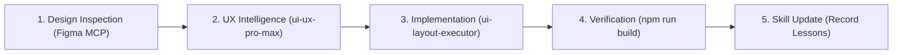
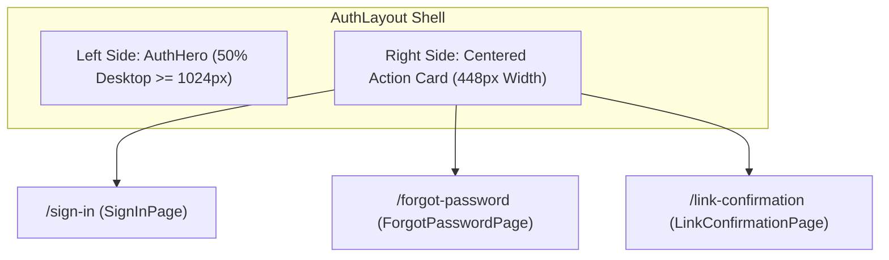

# Orbito v2 UI & Layout Implementation Guide (UI Layout Executor)

This guide documents the mandatory workflow, design tokens, common classes, and component patterns established for **Orbito v2** and the **inOrbit fleet** design system. 

> [!IMPORTANT]
> **Mandatory Rule:** Whenever planning or executing **ANY UI-related changes**, you **MUST** follow the pre-flight design analysis workflow in Section 1, adhere strictly to the layout architecture, and complete the post-implementation skill update protocol in Section 9.

---

## 1. Mandatory Pre-Flight Workflow: UI Analysis & UI/UX Pro Max

Before creating a plan or writing UI code, you must execute these two pre-flight analysis steps:



### Step 1.1: Inspect Source Design (Figma MCP)
If a Figma design URL or node ID is provided in instructions or prompt:
1. Extract the `fileKey` (e.g. `HoTxCrL3KrH5bblZDaw844`) and optional `nodeId` (e.g. `3004:240`).
2. Call the `figma` MCP tool `get_figma_data` with `{ "fileKey": "...", "nodeId": "..." }`.
3. Extract layout hierarchies, dimensions, padding, colors, and typography styles directly from the node tree.
4. If image assets or custom vector graphics are needed, use `download_figma_images` to save them directly to `frontend/src/assets/` or `frontend/src/components/common/icons/`.

### Step 1.2: Run UI/UX Pro Max Design Intelligence
Always invoke the globally installed **`ui-ux-pro-max`** skill via CLI to analyze design patterns, UX outcomes, and stack best practices:

```bash
# 1. Product & Design System Guidance (Color harmony, visual hierarchy, typography)
python3 ~/.agents/skills/ui-ux-pro-max/scripts/search.py "<product_feature> enterprise telematics" --design-system -p "Orbito Fleet"

# 2. Targeted UX & Accessibility Outcomes (WCAG 2.1 AA, touch targets, focus states)
python3 ~/.agents/skills/ui-ux-pro-max/scripts/search.py "<component_name_or_interaction>" --domain ux

# 3. Stack-Specific Implementation Guidance (Tailwind CSS 4 & React 18)
python3 ~/.agents/skills/ui-ux-pro-max/scripts/search.py "<concern>" --stack html-tailwind
python3 ~/.agents/skills/ui-ux-pro-max/scripts/search.py "<concern>" --stack react
```

---

## 2. Quick Reference: The 5-Layer Layout System

```text
1. Shell:        AppLayout (SkipToContent link, Sidebar, Header, fluid layout-container)
2. Navigation:   Sidebar (Desktop 256px / Tablet mini 80px / Mobile drawer 288px)
3. Topbar:       Header (Mobile hamburger, global search, notifications bell, user menu)
4. Context Bar:  PageHeader (Breadcrumbs, Title + status badge, description, responsive actions)
5. Content Area: Fluid Canvas (100% width, responsive gutters, horizontal table scrolling)
```

---

## 3. Design Tokens & Color Variables

All colors and visual properties are defined in [`frontend/src/index.css`](file:///Users/soham18/Desktop/orbito-v2/frontend/src/index.css). Always use these tokens instead of ad-hoc hex values:

| Token / Variable | Hex Value | Usage |
|---|---|---|
| `--color-brand-primary` | `#2563EB` | Active nav items, primary buttons, avatar backgrounds |
| `--color-brand-primary-hover` | `#1D4ED8` | Primary button hover state |
| `--color-brand-accent-cyan` | `#95F8FF` | "fleet" pill badge, telematics indicators |
| `--color-sidebar-bg` | `#0F172B` | Dark navy sidebar background (light & dark mode) |
| `--color-sidebar-border` | `#1D293D` | Sidebar right border, dividers, card borders |
| `--color-sidebar-item-idle` | `#7B7F8A` | Inactive nav links |
| `--color-status-danger` | `#EF4444` | Notification badges, alert counters, delete actions |
| `--color-status-success` | `#10B981` | Active entity status, connected status dot |
| `--color-status-warning` | `#F59E0B` | Expiry warning, caution indicators |

---

## 4. Common Utility Classes (`@layer components`)

Orbito v2 provides pre-built utility classes in `index.css`. Always prefer these over duplicate utility strings:

### 4.1 Surfaces & Panels
- **`.panel-card`**: Standard card surface with 16px radius, border, and elevation (adapts to light and dark modes).
- **`.panel-glass`**: Glassmorphic surface with backdrop blur for headers, sticky bars, and overlays.
- **`.panel-sidebar`**: Exact dark navy canvas styling for sidebar components.

### 4.2 Interactivity & Accessibility (A11y)
- **`.focus-ring`**: WCAG 2.1 AA compliant keyboard focus ring (`focus-visible:ring-2 focus-visible:ring-blue-500 focus-visible:ring-offset-2`).
- **`.touch-target`**: Minimum 44x44px touch-friendly hit area (`min-h-[44px] min-w-[44px]`).

### 4.3 Navigation States
- **`.nav-item-base`**: Common transition, padding, border-radius, and font styling for navigation links.
- **`.nav-item-active`**: Royal blue pill (`#2563EB`) with subtle elevation shadow and white text.
- **`.nav-item-idle`**: Inactive navigation state (`#7B7F8A` with `#1D293D` hover).

### 4.4 Badges & Pills
- **`.badge-pill`**: Standard rounded pill container with uppercase tracking.
- **`.badge-alert`**: Small red capsule for notification and alert counts (e.g. `3`).
- **`.badge-cyan`**: Cyan italic capsule for brand badges.
- **`.badge-counter`**: Clean slate counter badge for entity totals (e.g. `48 USERS`).

### 4.5 Responsive Containers
- **`.layout-container`**: Full-bleed fluid padding (`px-4 py-4 sm:px-6 sm:py-6 lg:px-8`).
- **`.toolbar-responsive`**: Action toolbar that stacks vertically on mobile (`flex-col`) and aligns horizontally on tablet/desktop (`sm:flex-row`).

---

## 5. The Common Icons Module (`frontend/src/components/common/icons/`)

Never copy-paste inline SVGs or import disparate icon libraries across files. Use the centralized icons module:

```tsx
import { AppIcon, InOrbitLogo, AuditLogIcon, SupportIcon } from "@/components/common/icons";
import { Plus, Filter, Download } from "lucide-react";

// 1. Standard decorative icon (aria-hidden by default)
<AppIcon icon={Plus} size="sm" />

// 2. Interactive or meaningful icon with accessible label
<AppIcon icon={Filter} size="md" ariaLabel="Filter results" />

// 3. Exact Figma Brand Logo (supports collapsed state)
<InOrbitLogo collapsed={false} />
```

---

## 6. The Standard `PageHeader` Pattern

Every new entity, analytics, or administration page **MUST** use the `PageHeader` component from [`frontend/src/components/layout/PageHeader`](file:///Users/soham18/Desktop/orbito-v2/frontend/src/components/layout/PageHeader/PageHeader.tsx):

```tsx
import React from "react";
import { Plus, Download, RefreshCw } from "lucide-react";
import { PageHeader } from "@/components/layout/PageHeader";
import { Button } from "@/components/common/Button";

export const EntityList: React.FC = () => {
  return (
    <div className="space-y-6">
      <PageHeader
        breadcrumbs={[
          { label: "System Config", href: "/system-config" },
          { label: "Vehicles" }
        ]}
        title="Vehicle Fleet Overview"
        badge="1,248 ACTIVE"
        badgeVariant="cyan"
        description="Monitor connected telematics units, battery levels, maintenance schedules, and active routes."
        actions={
          <>
            <Button variant="secondary" icon={RefreshCw} onClick={handleRefresh}>
              Refresh
            </Button>
            <Button variant="primary" icon={Plus} onClick={handleCreate}>
              Add Vehicle
            </Button>
          </>
        }
      />

      {/* Main page content (e.g. AppDataTable / Metrics cards) */}
    </div>
  );
};
```

---

## 7. Adding Navigation Items

**NEVER** hardcode routes into `Sidebar.tsx`. Add them to [`frontend/src/components/layout/Sidebar/navigation.config.ts`](file:///Users/soham18/Desktop/orbito-v2/frontend/src/components/layout/Sidebar/navigation.config.ts):

```typescript
{
  key: "vehicles",
  name: "Vehicles",
  path: "/vehicles",
  icon: Car,
  permission: "VIEW:VEHICLE", // Checked automatically via hasPermission()
  badge: 12,                  // Optional notification count
  badgeType: "alert"
}
```

---

## 8. Responsive Rules (Mobile & Tablet)

Follow these rules for all new pages to maintain mobile and tablet excellence:

1. **Touch Targets (Mobile):** Every clickable button, link, or icon trigger on mobile must have at least `44px` height/width (`min-h-[44px] min-w-[44px]` or `.touch-target`).
2. **Horizontal Table Overflow:** Wrap data tables in a negative-margin container on mobile:
   ```tsx
   <div className="-mx-4 sm:mx-0 overflow-x-auto">
     <AppDataTable ... />
   </div>
   ```
3. **Responsive Action Toolbars:** Use `.toolbar-responsive` so action buttons stack cleanly on small phones (`< 640px`) without clipping off-screen.
4. **Adaptive Tablet Mode:** Tablets (768px–1024px) automatically collapse the sidebar to 80px to give maximum width to data tables. Ensure your tables support 80px offset cleanly.
5. **Fluid Widths:** Do not constrain pages with arbitrary `max-w-7xl` wrappers unless creating a reading/article document. Enterprise dashboards should stretch fluidly across wide 1080p+ screens.
6. **Smooth Sidebar Transitions & Collapsed State Architecture:**
   - **Fluid Text Transitions:** When animating sidebar expansion/collapse (256px ↔ 80px), retain DOM elements and transition `max-w-[160px] opacity-100 translate-x-0` ↔ `max-w-0 opacity-0 -translate-x-2` with `overflow-hidden whitespace-nowrap transition-all duration-300 ease-in-out` to avoid abrupt disappearances.
   - **Synchronized Shell Widths:** Synchronize the outer `<aside>` width and inner `fixed` container width with identical transition timings (`transition-[width] duration-300 ease-[cubic-bezier(0.4,0,0.2,1)]`) so the main layout content adjusts smoothly without jitter.
   - **Uniform Collapsed Bounding Box:** In collapsed mini-mode (80px), all interactive items (navigation links, avatar profiles, collapse buttons) must share a uniform bounding box (`w-11 h-11 mx-auto justify-center !p-0 !gap-0 rounded-xl`).
   - **Badge & Spacing Isolation:** Never keep expanded badge containers (`badge-alert` with `ml-auto`) or text gaps active in collapsed mode; flexbox will allocate space to them and squash or clip the adjacent icon wrapper (e.g. causing alert icons or avatar rings to crop). In collapsed mode, represent notifications as a compact pulsing dot directly pinned to the icon's top-right corner (`absolute -top-1 -right-1.5`) and surface full counts inside floating tooltips (`md:group-hover:flex`).
   - **Balanced Collapsed Dividers:** Replace full section headings with clean, centered mini-dividers (`border-t border-[#1D293D]/80 w-8 mx-auto my-1.5`) with tight vertical spacing (`space-y-2.5`) to eliminate gaping holes between icon groups while preserving visual hierarchy.
7. **Zero-Scroll Viewport Lockdown:**
   - The root application canvas (`AppLayout` or `AuthLayout`) must lock to the exact viewport height (`h-screen overflow-hidden`).
   - Only designated internal containers (e.g. `<main className="overflow-y-auto">`) should scroll vertically.
   - Absolute decorative background elements (like radial blur orbs) must always reside inside an `overflow-hidden` container to avoid creating phantom scrollbars.

---

## 9. Authentication Flow & Split-Screen Shell (`AuthLayout`)

All authentication and account recovery views adhere to a unified, responsive split-screen canvas based on Figma node `#3004:240`:



### 9.1 Component Structure
- **`AuthLayout.tsx`:** Manages the responsive grid (`grid grid-cols-1 lg:grid-cols-2`). Displays a compact brand banner on mobile/tablet (`< lg`) and full `AuthHero` on desktop.
- **`AuthHero.tsx`:** Renders [`InOrbitLogo`](file:///Users/soham18/Desktop/orbito-v2/frontend/src/components/common/icons/InOrbitLogo.tsx), headline, 3 feature value cards (*Real-time GPS*, *RBAC Governance*, *Predictive Diagnostics*), and SOC2/ISO compliance trust badges.
- **Action Cards:** Wrapped in `.panel-card` (`max-w-md w-full`) with consistent typography, `.touch-target` triggers, and `.focus-ring`.

### 9.2 Accessibility Rules for Auth Forms (WCAG 2.2 AA)
1. **Never Block Paste:** Allow password managers (1Password, Bitwarden, Apple Keychain) to paste freely without `preventDefault`.
2. **Auto-Fill Hints:** Always provide semantic `autoComplete` attributes (`"username"`, `"current-password"`, `"email"`, `"tel"`).
3. **Accessible Password Toggle:** Password visibility toggles must have `aria-label={showPassword ? "Hide password" : "Show password"}` and `aria-pressed={showPassword}`.
4. **Resend Cooldown:** Any resend link actions must enforce an interactive cooldown timer (60s) to prevent spamming.

---

## 10. Post-Implementation Learning & Skill Update Protocol

To ensure continuous improvement and permanently avoid repeating mistakes:

> [!IMPORTANT]
> **Curated Knowledge Rule:** Skills are **NOT** changelogs, commit histories, or task debug logs. Never add one-off bug fixes or temporary workarounds to skills. ONLY record **reusable standards, architectural patterns, design tokens, and universal conventions** that developers and agents must adhere to whenever building similar features in the future.

1. **Evaluate Significance:** Only update skills if the work established:
   - A new design token, common CSS utility, or global layout requirement.
   - An architectural pattern or reusable component convention (e.g. animated sidebar collapse without content jump, auth layout split screen).
   - A crucial rule or checklist item that prevents a recurring class of issues.
2. **Update the Matching Skill:**
   - If related to UI, layout, tokens, or components → Update [`ui-layout-executor/SKILL.md`](file:///Users/soham18/Desktop/orbito-v2/.agents/skills/ui-layout-executor/SKILL.md).
   - If related to dependencies or scripts → Update [`tech-stack/SKILL.md`](file:///Users/soham18/Desktop/orbito-v2/.agents/skills/tech-stack/SKILL.md).
   - If related to backend layers or state patterns → Update [`architecture/SKILL.md`](file:///Users/soham18/Desktop/orbito-v2/.agents/skills/architecture/SKILL.md).
3. **Create New Skills for Major Domains:**
   - When implementing a major new feature domain (e.g. Telematics Maps, Reporting Engine, Exporting), create a new skill in `.agents/skills/<domain>/SKILL.md` and register it in [`AGENTS.md`](file:///Users/soham18/Desktop/orbito-v2/AGENTS.md).
4. **Document Reusable "Do's and Don'ts":** Add universal guidelines directly to the table below so future agent runs avoid the mistake automatically. Avoid recording one-off issue logs.

---

## 11. The "Do's and Don'ts" Checklist

| Do's (Good Practices) | Don'ts (Wrong Things to Avoid) |
|---|---|
| **DO** inspect source Figma URLs via Figma MCP and run `ui-ux-pro-max` before planning or coding UI. | **DON'T** start coding UI without checking the source design or running UX intelligence. |
| **DO** use `AuthLayout` for all login, forgot password, and confirmation flows. | **DON'T** create standalone, inconsistent login screens with disparate background styles. |
| **DO** allow password managers to paste freely and use `autoComplete` attributes. | **DON'T** block paste on password inputs (`preventDefault` on paste). |
| **DO** provide accessible password visibility toggle with `aria-label` and `aria-pressed`. | **DON'T** create unlabelled icon buttons without accessible descriptions. |
| **DO** use `PageHeader` for all entity and dashboard views. | **DON'T** manually craft custom `<h1>` headers with mismatched margins. |
| **DO** use tokens (`--color-brand-primary`, etc.) or Tailwind `@theme` classes. | **DON'T** hardcode arbitrary hex colors like `#2563EB` directly in JSX. |
| **DO** wrap icons in `AppIcon` or use the common icons barrel. | **DON'T** copy-paste raw `<svg>` elements or import icons from multiple libraries. |
| **DO** assign RBAC permissions in `navigation.config.ts`. | **DON'T** hardcode menu items in `Sidebar.tsx`. |
| **DO** ensure all buttons have `.focus-ring` for keyboard users. | **DON'T** remove focus outlines without providing a visible focus indicator. |
| **DO** use `h1` in `PageHeader` and sequential `h2`/`h3` in sections. | **DON'T** skip heading levels (`h1` -> `h4`) which breaks screen readers. |
| **DO** update skills after completing any feature to capture lessons learned. | **DON'T** finish a task without recording new patterns or resolved mistakes. |
| **DO** run `cd frontend && npm run build` before finishing. | **DON'T** introduce TypeScript errors or suppress them with `@ts-ignore`. |
